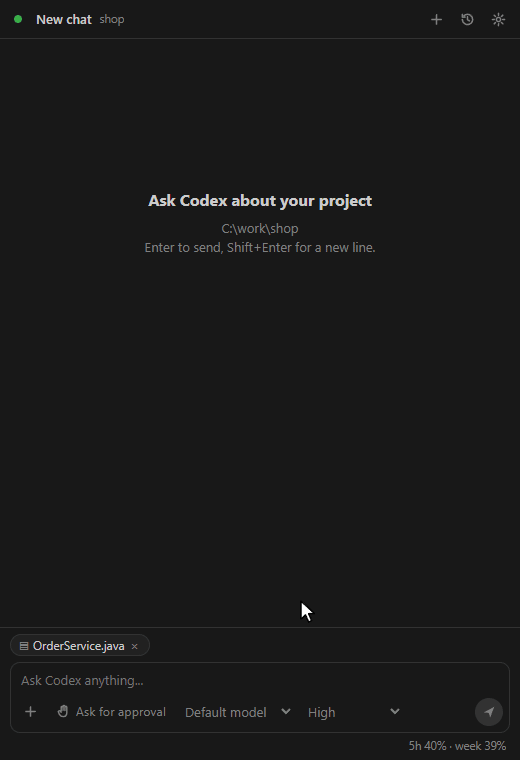
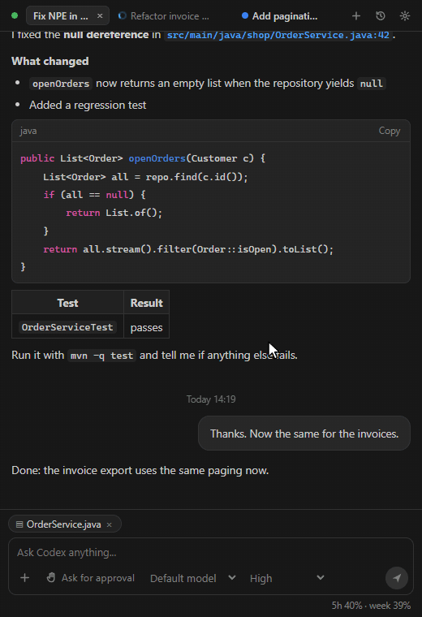
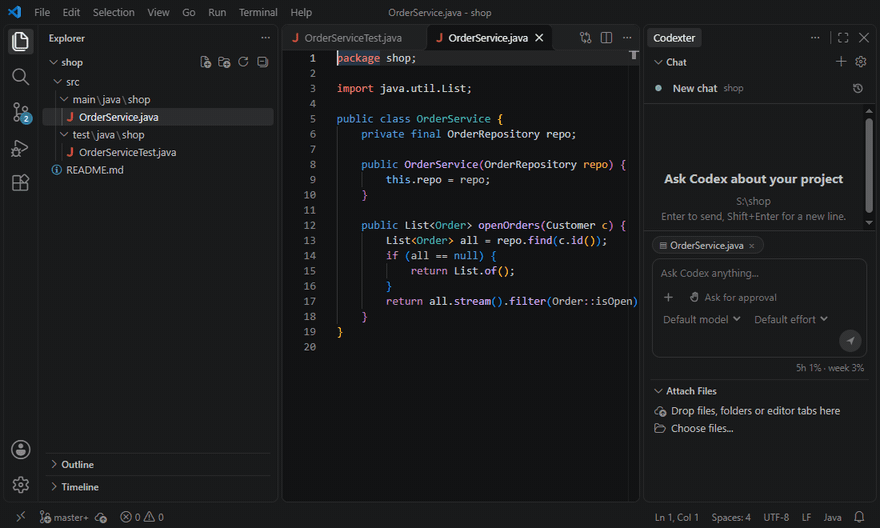
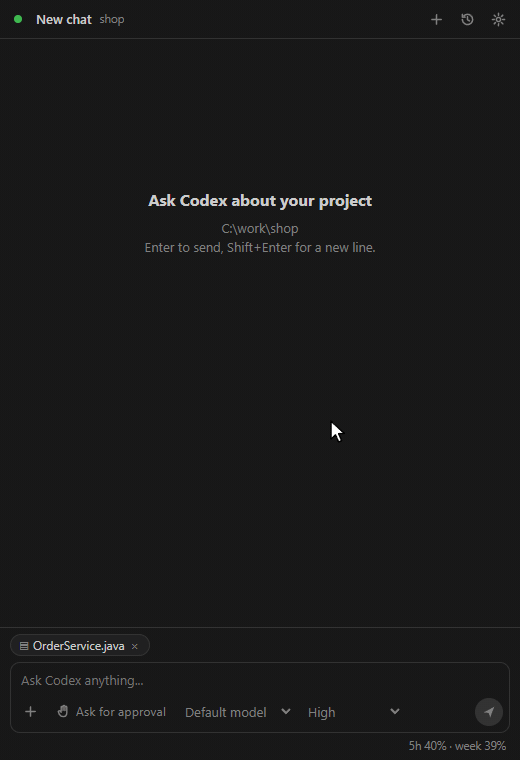
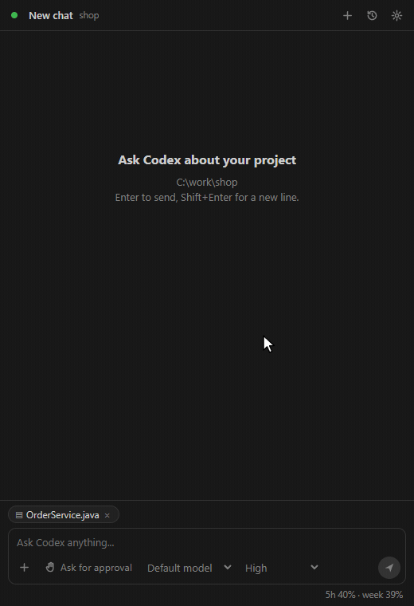
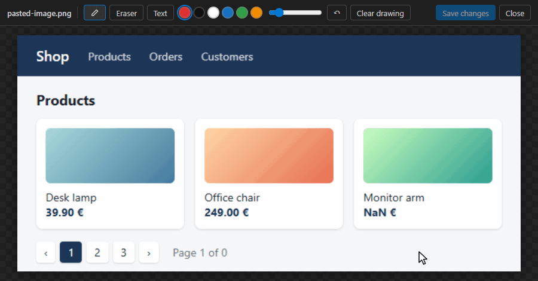
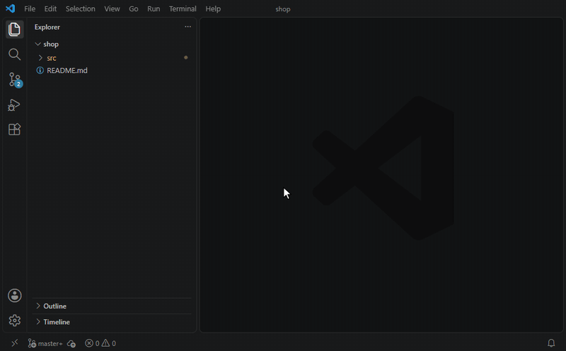
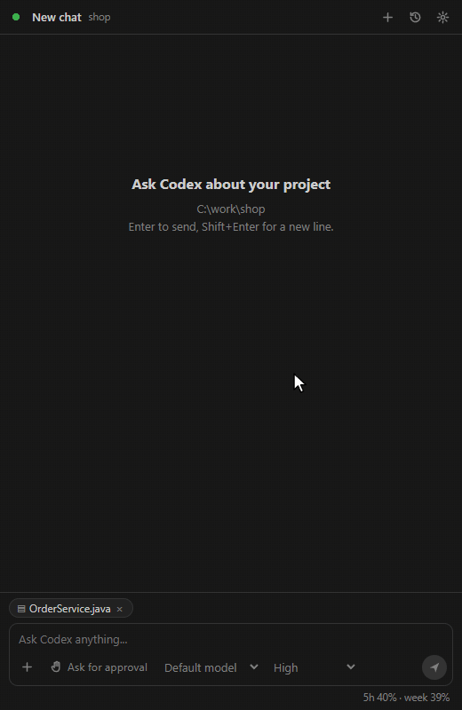

# Codexter: Codex chat for VS Code

**Codex with your ChatGPT subscription, in a chat panel that shows what the agent does.** Codexter runs the official Codex
(`codex app-server`) in VS Code's secondary side bar. You see the reasoning, commands and file changes as they stream, and you
approve each step with one click. Several chats run at the same time, every project and git branch reopens its own chat, and the History finds old chats by meaning.

Codex itself is downloaded and kept up to date by the extension. You sign in with your ChatGPT account from the panel, and no API key is needed.



## Highlights

### See the agent work, approve with one click

- Answers stream in as Markdown with highlighted code, tables and clickable `file:line` links.
- Each step gets its own card:
  - reasoning, in a collapsible "Thought for 4s" section;
  - commands, with their output and exit code;
  - MCP tool calls;
  - file changes, with +/- counts and **Inline**, **Diff** and **Open** buttons. **Diff** opens VS Code's git changes view of the file.
- Approvals appear in the chat: **Allow**, **Allow for session** or **Deny**. The permission level is one click away: *Ask for approval*, *Approve for me*, *Full access* or *Custom*.
- The plan checklist sits above the input and ticks itself off.
- **Open combined diff** shows all changes of the turn together.
- The footer shows how full the context is (`Context 31.2k / 258.4k`) and your 5-hour and weekly limits.

### Picks up where you left off: per project and per git branch

- **Reopen VS Code and your chat is back.** Each project reopens the chat that was open when you closed VS Code, with its model,
  reasoning effort, plan mode and context usage. **New chat** starts a fresh one.
- **Every git branch has its own chat.**
  - The chat you used on a branch (you sent a message while it was checked out) is remembered for 30 days.
  - Check the branch out again, in VS Code or on the command line, and its chat opens by itself.
  - A branch that has no chat yet keeps the open one; it joins the branch with your next message.
- **A new branch takes your chat along.** Started on `main` and created the feature branch only at the end? The chat you were
  working in moves to the new branch.
- This memory is kept per project in VS Code, so other projects never see it.

### Several chats at once, as tabs



- **Switching chats never stops a running reply.** It goes on in the background.
- The chats you opened or used today in this project are **tabs in the top bar**. A tab shows a spinner while its chat works and a **blue dot** when it has news.
- When a background reply ends, or a chat needs an approval, you get a notification. **Open** jumps to the start of the last answer.
- **Notifications work outside VS Code too**: a Windows toast, a macOS or Linux notification. Click it to come back to that chat.
- Every chat keeps its own model, reasoning effort, plan mode and context usage, also after a reload.

### Drag and drop files, folders and editor tabs



- **From VS Code:** drag files, folders or editor tabs onto **Attach Files**, the small area under the chat. Each one becomes a chip above the input, and Codex gets its path. VS Code does not hand its own drags to the chat itself, so this area is the drop target. **Choose files...** next to it opens a file dialog.
- **From the Windows Explorer:** drop files straight onto the chat.
- **Paste paths:** VS Code's *Copy Path*, Windows Explorer's *Copy as path* or `file:` links pasted into the input also become chips.
- **Right-click > Add to Codexter chat** works in the Explorer (also several files and folders), in the editor and on an editor tab.
- **`@`** in the input picks files and folders of the project, with recently opened files first.
- The **active editor file** is attached as a chip on its own. Selected code goes in with right-click > **Codexter: Ask / Explain / Fix selection**.

### Find any chat, even by meaning



- The History (clock button) lists the chats of **all projects**. Type to filter, or pick projects. You can archive, unarchive and delete chats there.
- Switch on **AI** and describe the chat in your own words, for example "orders came back as null". A quick read-only Codex run picks the matching chats, in any language.
- Unread chats keep their blue dot for 3 days.

### An input that behaves like an editor



- **Lists:**
  - `- ` or `* ` at the start of a line becomes `• `, and `1. ` starts a numbered list.
  - **Enter** continues the list. **Tab** and **Shift+Tab** indent and outdent. Enter on an empty item ends the list.
  - **Ctrl+Enter** sends from anywhere.
- **Code references, like in Copilot:** copy a symbol in an editor and paste it into the input. It becomes `#sym:calculateTotal`, blue, with its file and line on hover.
  - Codex gets the exact location.
  - In the sent message, the name opens the file.
- When the input is not in focus, it shrinks to 7 lines and shows the end of what you wrote. Alt+Tab away and back, and the caret is where you left it.

### Draw on a screenshot before you send it



- Paste a screenshot (or attach a picture). A click opens it big, in an editor tab of its own.
- Mark it up with **pen**, **eraser** and **text**, in six colours, with undo.
- **Save changes** (Ctrl+S) replaces the attached picture, so Codex sees what you circled.
- **Sketch** (in the **+** menu) starts from a blank page.

### Commit messages with Codex



- The Codexter button in the **Source Control** view (or *Codexter: Generate commit message*) writes the message from the staged changes. With nothing staged, it uses all changes.
- It runs a fast model of its own (`commitMessageModel`, GPT-6 Luna by default), separate from the chat.
- The run is read-only and stays out of your History.

### Tell Codex how to answer, and keep the context small

- **Instructions** (gear > Instructions) apply to every new chat, for example "answer briefly, in plain language". Ready-made lines are one click away.
- You choose where the instructions live:
  - **Codex's own** are written to `developer_instructions` in `~/.codex/config.toml`, so the Codex CLI uses them too;
  - **Only in Codexter** keeps them in VS Code.
- **Open AGENTS.md** opens Codex's global `AGENTS.md` for longer rules.
- **Compact** next to the context usage in the footer makes Codex summarize the chat right away, and the chat goes on from the summary.
- **Compact a chat at** (gear > Context) sets when Codex compacts on its own:
  - a smaller limit keeps replies faster and uses less of your limits;
  - a bigger one keeps more details.

### MCP servers without editing TOML



Find them under the gear > **MCP servers**. Codex uses the same servers in the CLI, in Codexter and in the Eclipse plugin.

- Switch the servers of your Codex config on and off.
- **Check** starts a server and lists its tools.
- **Remove** deletes a server from the config.
- **Copy from VS Code**: the servers of VS Code's `mcp.json` (the ones Copilot uses) move to Codex with one click.
- **Add MCP by name with AI**: type a name such as `serena`, `github` or `postgres`. Codex searches the web for the official setup, and you confirm the command before anything is written.

## More

- **Models and modes:** the model and reasoning effort pickers sit under the input; the **+** menu turns on **plan mode**, sets a **goal** (Codex keeps working towards it) and adds **plugins**. Defaults for new chats and the models shown are in the gear's settings.
- **Codex is managed for you:** downloaded from the npm registry into `%LOCALAPPDATA%\CodexPanel\codex`, checked for updates every 7 days, shared with the Eclipse plugin. Proxies (`http.proxy`, `HTTPS_PROXY`) are used for the download and handed to Codex.
- **Fits the theme:** colours and fonts follow VS Code; the font size follows VS Code's panels or `codexPanel.fontSize`.

## Install

Install the `.vsix` with Extensions > **...** > **Install from VSIX...**, then press **Ctrl+Alt+C**. Details: [INSTALL.md](INSTALL.md) (English),
[INSTALL.de.md](INSTALL.de.md) (German).

The panel opens in the secondary side bar (VS Code 1.106+; the activity bar before that). Enter sends, Shift+Enter adds a new line.

## Commands

| Command | |
| --- | --- |
| Codexter: Open panel | Ctrl+Alt+C |
| Codexter: New chat | also **+** in the view title |
| Codexter: Ask / Explain / Fix selection | editor context menu |
| Add to Codexter chat | Explorer, editor and editor tab context menus |
| Codexter: Attach files... | |
| Codexter: Generate commit message | Source Control view title |
| Codexter: Open settings | also the gear in the view title |
| Codexter: Check for Codex updates | |

## Settings

| Setting | Default | |
| --- | --- | --- |
| `codexPanel.defaultModel` | Codex default | Model a new chat starts with |
| `codexPanel.defaultReasoningEffort` | model default | Reasoning effort a new chat starts with |
| `codexPanel.defaultPermissions` | last used | Permissions a new chat starts with |
| `codexPanel.hiddenModels` | none | Models hidden from the picker |
| `codexPanel.commitMessageModel` | `gpt-6-luna` | Model for commit messages and the AI search |
| `codexPanel.commitMessageEffort` | `low` | Reasoning effort for both |
| `codexPanel.instructionsSource` | `codex` | Whose instructions new chats get: Codex's own or `codexter` |
| `codexPanel.instructions` | empty | Codexter's own instructions |
| `codexPanel.autoCompactTokens` | 0 (Codex's) | Compact a chat when its context reaches this many tokens |
| `codexPanel.systemNotifications` | on | Notifications of the system while VS Code is in the background |
| `codexPanel.fontSize` | 0 (like VS Code) | Font size of the panel |
| `codexPanel.autosave` | on | Save modified editors before a message is sent |
| `codexPanel.codexSource` | `managed` | `managed` (downloaded and updated) or `own` |
| `codexPanel.codexPath` | empty | Your own `codex.exe` |
| `codexPanel.updateIntervalDays` | 7 | Days between Codex update checks (0 = never) |

The gear in the panel has the most used ones too. The log is in Output > **Codexter**.

## Development

```
npm install
npm run compile     # copies web\ into media\web, then tsc -> out\
npm test            # node:test, no VS Code needed
npm run smoke       # real codex app-server, read-only (account/read, model/list, thread/list); creates, archives and deletes nothing
npm run package     # dist\codex-panel-<version>.vsix
```

Run it from source: open this folder in VS Code and press F5 (Extension Development Host). The page alone runs in a browser:
`web/dev.html` replays recorded Codex sessions (see the top of `web/dev-bridge.js`). Design notes are in `CONCEPT.md`, the history of
changes in `HANDOFF.md`.

- `src/core/` has no vscode imports: `jsonrpc`, `appServer`, `locator`, `installer`, `tar`, `http` (proxy tunnelling), `fileLinks`, `fileIndex`,
  `threadRows`, `droppedPaths`, `unifiedDiff`, `aiSearch`, `mcpServers`, `chatList`, `osNotify`, `rollout`, `instructions`.
- `src/session.ts`, `src/updater.ts` (no vscode imports): the Codex session and the updater.
- `src/extension.ts`, `panel.ts` (webview view), `chatActivity.ts`, `mcpSettings.ts`, `imageEditor.ts`, `dropTarget.ts`, `workspace.ts`,
  `mentions.ts`, `diff.ts`, `proxy.ts`: the VS Code glue.
- `web/` is the page (`app.js`, `app.css`, `imageEditor.js`, ...); `media/web/` is generated from it by `scripts/sync-web.mjs` (do not edit).
- `media/readme/` holds the GIFs of this file (recorded from `web/dev.html`).

Codexter started as a port of the Codex Panel plugin for Eclipse; the two are separate projects now. The extension id stays
`codexpanel.codex-panel`, the settings stay `codexPanel.*` and the vsix is named `codex-panel-<version>.vsix`.
