# Codexter: Codex chat for VS Code

**An unofficial chat panel for OpenAI Codex with your ChatGPT subscription.** Codexter runs the original Codex (`codex app-server`)
in VS Code's secondary side bar and adds what makes it fit daily work:
- every project and git branch reopens its own chat;
- several chats run at once, as tabs, with notifications even outside VS Code;
- the History finds old chats by meaning, and chats name themselves by what they are about;
- dictation: speak, and your words land in the input as text;
- edit your last message, fork a new chat from any answer, ask about one line of an answer in a side chat (**Clarify**);
- commit messages, screenshots you can draw on, `#sym` code references;
- MCP servers and instructions without editing TOML.

Codex itself is downloaded and kept up to date by the extension, from the official npm package `@openai/codex`
(registry.npmjs.org, integrity-checked); set *Codexter > Codex Source* to `own` to use a Codex you installed yourself.
You sign in with your ChatGPT account from the panel: Codex handles the sign-in itself, and no API key is needed.

Runs on Windows, macOS and Linux (x64 and arm64). It is developed and tested on Windows; the Codex download for macOS and Linux
is new in 0.9.0 and has not been tried on real machines yet, so please report what you see.

> Codexter is a community project, not affiliated with or endorsed by OpenAI. Codex and ChatGPT are trademarks of OpenAI.

## Highlights

### Every project and git branch reopens its own chat

- **Reopen VS Code and your chat is back.** Each project reopens the chat that was open when you closed VS Code, with its model,
  reasoning effort, plan mode and context usage. **New chat** starts a fresh one.
- **Every git branch has its own chat.**
  - The chat you used on a branch (you sent a message while it was checked out) is remembered for 30 days.
  - Check the branch out again, in VS Code or on the command line, and its chat opens by itself.
  - A branch that has no chat yet keeps the open one; it joins the branch with your next message.
- **A new branch takes your chat along.** Started on `main` and created the feature branch only at the end? The chat you were
  working in moves to the new branch.

### Several chats at once, as tabs

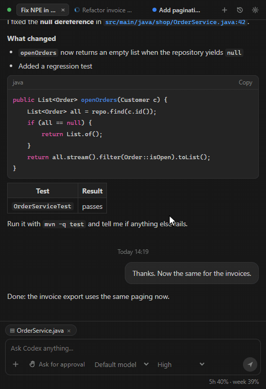

- **Switching chats never stops a running reply.** It goes on in the background.
- The chats you opened or used today in this project are **tabs in the top bar**. A tab shows a spinner while its chat works and a **blue dot** when it has news.
- When a background reply ends, or a chat needs an approval, you get a notification. **Open** jumps to the start of the last answer.
- **Notifications work outside VS Code too**: a Windows toast, a macOS or Linux notification. Click it to come back to that chat.

### Find any chat by meaning

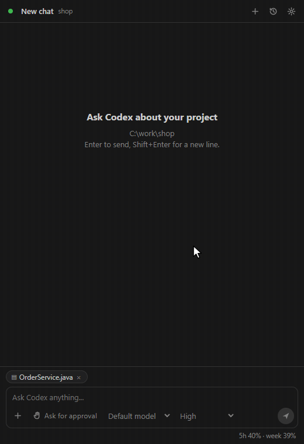

- The History lists the chats of **all your projects** in one place.
- Switch on **AI** and describe the chat in your own words, for example "orders came back as null". A quick read-only Codex run picks the matching chats, in any language.

### Chats name themselves

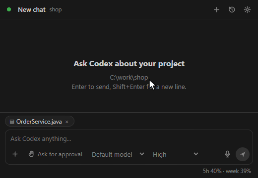

- A new chat is called after your first message, which is often a long "hey, quick one...". After the first answer, the chat
  gets a **short name by what it is about**, in the title, the tabs and the History.
- Every 5 answers the name is renewed if the topic moved on.
- **A name you set yourself is kept.** Rename a chat with a double-click on its title or tab, F2, or the pencil in the History;
  the **sparkle** in the rename box suggests a name.
- The names are saved in Codex, so the Codex CLI shows them too.
- Each name is a small request with the fast model of the commit messages (GPT-6 Luna by default). Gear > **AI chat names**
  switches it off or keeps only the first name.

### Dictate instead of typing (experimental)

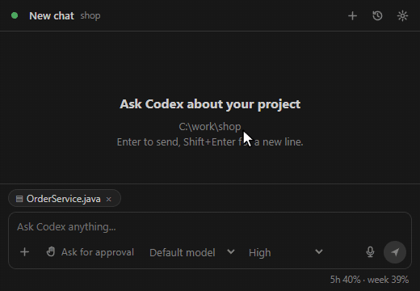

- Click the **microphone** next to Send and speak, in any language. The bars beside it show that you are heard.
- After each pause, the phrase lands in the input at the caret, so you can fix it before you send. Nothing is sent by itself.
- Click again or press **Esc** to stop.
- It uses Codex's voice mode with your ChatGPT plan, no API key.
- Keep in mind:
  - **It uses tokens of your plan** the whole time the microphone is on.
  - It is Windows only for now.
  - The voice mode is still experimental in Codex itself, so a Codex update may break it.
- Gear > **Dictation** shows or hides the button.
- **Your languages** (gear > *Dictation languages*): tick the ones you speak, English by default. Codex's voice mode has no
  language option of its own, so the voice model is told your languages. A phrase written in another script, for example
  Chinese while you speak Russian, is left out, and a note asks you to say it again. *Any language* switches this off.

### Edit your last message, fork from any answer

- **Forgot something?** Hover your last message and click the pencil; a running reply is stopped. The text and pictures go back
  into the input, and sending replaces the message and its answer. Files Codex already changed stay changed. Esc or Cancel keeps
  the chat as it was.
- **Fork** under any answer opens a new chat with the conversation up to that answer, named "<title> (fork)". The original chat
  stays as it is, so you can try another way without losing the first one.
- Codex does not delete a chat while a fork of it exists. Deleting it in the History asks whether to delete its forks too (forks of
  forks included).

### Clarify: ask about one line of an answer

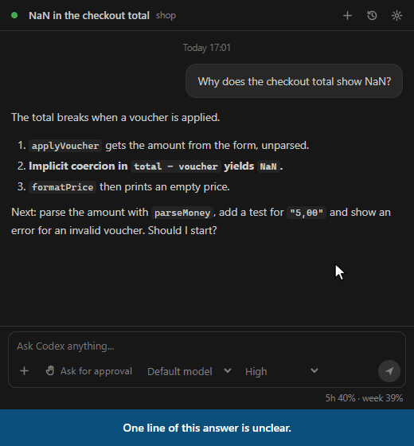

Something in a long answer is unclear, but asking in the chat would pull it off course. Ask on the side instead.

- **Clarify** under any answer or plan (a review answer too) opens a side chat that slides in from the right. It knows the chat up to that
  answer; your questions and its replies appear only there, and the main chat gets nothing and is not continued.
- The side chat is **read-only**: Codex can read files to answer, but nothing can be changed and nothing is run that asks for
  permission. The panel's header quotes the answer it belongs to.
- The button then reads "2 clarifications" and reopens them (tabs 1, 2 and **+ New** in the pane). The links are kept per
  answer, also after a restart. Side chats are not listed in the History.
- It is a fork of the chat, so a question costs about as much as a turn in a long chat. The fork is made with the first question.
- Deleting a chat in the History asks whether to delete its forks too; its side chats are among them.

### Code review, one finding at a time

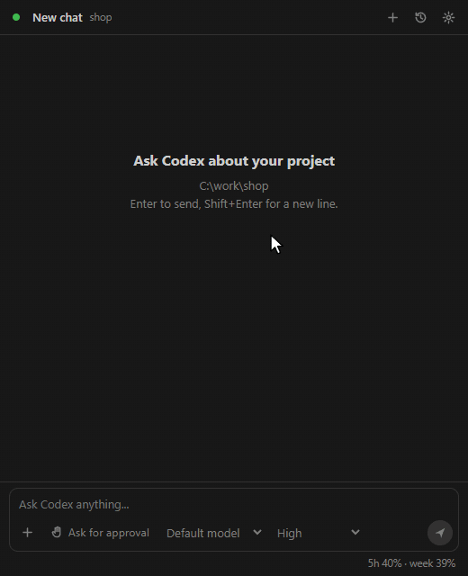

- Each project keeps its own review instructions in `REVIEW_INSTRUCTIONS.md`. The gear > **Code review** links to the file, or
  creates it from a template when the project has none. It may sit in the chat's folder or higher up, as far as the repository root.
- Pick **Code review** in the **+** menu of the input (or run *Codexter: Code review*). Codex gets the file as it is in the editor,
  unsaved changes included. Text in the input is added to it, for example "against develop" or "only the API folder". Without the
  file Codexter uses a default: the uncommitted changes and the branch's commits, bugs first.
- Codex reviews in the open chat. When it has finished, its findings appear as cards under the answer, one at a time: the
  severity as a colour (red critical, yellow medium, green suggestion), the problem, links to file:line that open the editor,
  and the suggested fix.
- On each card pick **Fix**, **Skip** or **Own answer** (a text field: tell Codex what to do instead). The next card follows at
  once, as all findings are known up front. **Back**, the dots above the card and the overview at the end let you change any
  answer.
- **Send answers to Codex** sends them as the next message of the same chat: Codex fixes the Fix items, follows your own answers
  and leaves the skipped ones alone.
- If Codex ends without findings in the expected format, its answer stays as it is and a short note says so.

### Commit messages with Codex

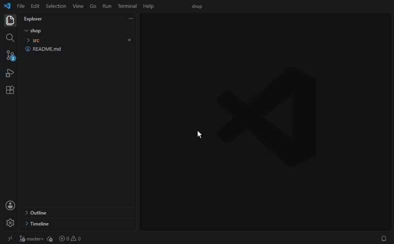

- The Codexter button in the **Source Control** view (or *Codexter: Generate commit message*) writes the message from the staged changes. With nothing staged, it uses all changes, new files included.
- It runs a fast model of its own (`commitMessageModel`, GPT-6 Luna by default), separate from the chat.
- The run is read-only and stays out of your History.

### Draw on a screenshot before you send it

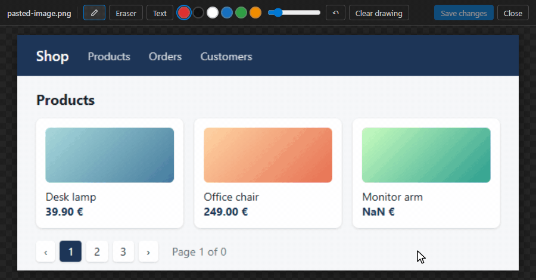

- A click on an attached picture opens it big, in an editor tab of its own.
- Mark it up with **pen**, **eraser** and **text**, in six colours, with undo.
- **Save changes** (Ctrl+S) replaces the attached picture, so Codex sees what you circled.
- An image attached as a file (png, jpg, gif, webp, bmp) opens there too. Saving attaches the drawn-on copy in place of the file;
  the file itself is not changed.
- **Sketch** (in the **+** menu) starts from a blank page.

### Code references and lists in the input

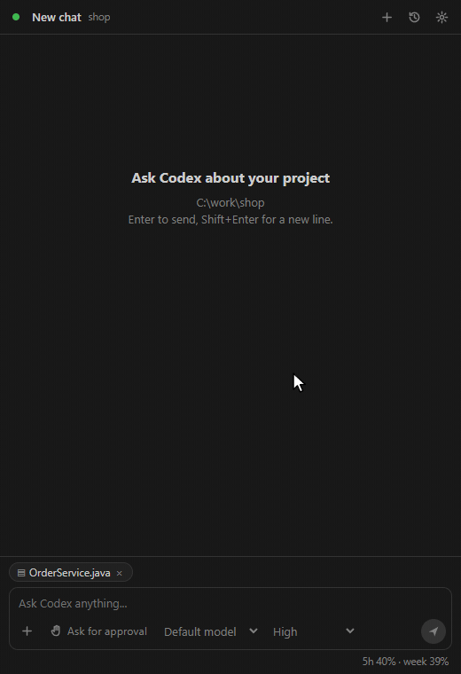

- **Code references, like in Copilot:** copy a symbol in an editor and paste it into the input. It becomes `#sym:calculateTotal`, blue, with its file and line on hover.
  - Codex gets the exact location.
  - In the sent message, the name opens the file.
- **Lists:**
  - `- ` or `* ` at the start of a line becomes `• `, and `1. ` starts a numbered list.
  - **Enter** continues the list. **Tab** and **Shift+Tab** indent and outdent. Enter on an empty item ends the list.
  - **Ctrl+Enter** sends from anywhere.
- Alt+Tab away and back, and the caret is where you left it.

### Drag and drop files, folders and editor tabs

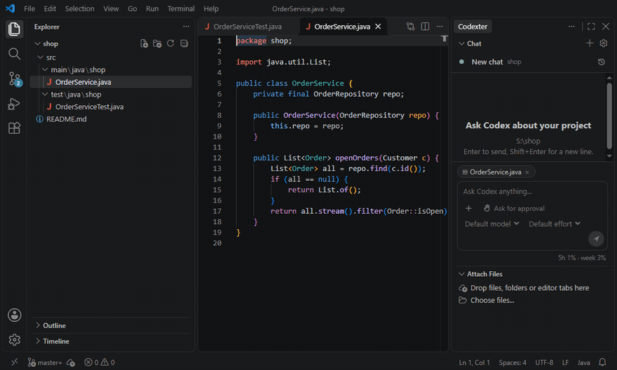

- **From VS Code:** drag files, folders or editor tabs onto **Attach Files**, the small area under the chat. Each one becomes a chip above the input, and Codex gets its path. VS Code does not hand its own drags to the chat itself, so this area is the drop target. **Choose files...** next to it opens a file dialog.
- **From the Windows Explorer:** drop files straight onto the chat.
- **Paste paths:** VS Code's *Copy Path*, Windows Explorer's *Copy as path* or `file:` links pasted into the input also become chips.
- **Right-click > Add to Codexter chat** works in the Explorer (also several files and folders), in the editor and on an editor tab.

### MCP servers without editing TOML

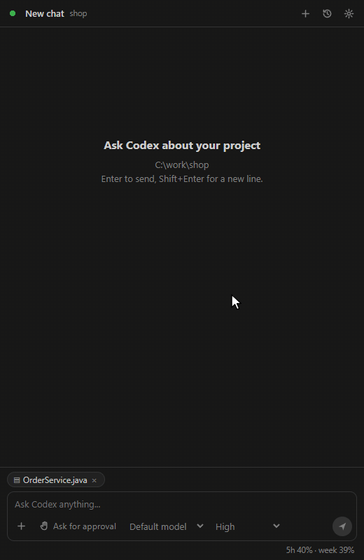

Find them under the gear > **MCP servers**. Codex uses the same servers in the CLI, in Codexter and in the Eclipse plugin.

- Switch the servers of your Codex config on and off.
- **Check** starts a server and lists its tools.
- **Remove** deletes a server from the config.
- **Copy from VS Code**: the servers of VS Code's `mcp.json` (the ones Copilot uses) move to Codex with one click.
- **Add MCP by name with AI**: type a name such as `serena`, `github` or `postgres`. Codex searches the web for the official setup, and you confirm the command before anything is written.

### Tell Codex how to answer, and keep the context small

- **Instructions** (gear > Instructions) apply to every new chat, for example "answer briefly, in plain language". Ready-made lines are one click away.
- You choose where the instructions live:
  - **Codex's own** are written to `developer_instructions` in `~/.codex/config.toml`, so the Codex CLI uses them too;
  - **Only in Codexter** keeps them in VS Code.
- **Open AGENTS.md** opens Codex's global `AGENTS.md` for longer rules.
- **Compact** next to the context usage in the footer makes Codex summarize the chat right away, and the chat goes on from the summary.
- **Compact a chat at** (gear > Context) sets when Codex compacts on its own:
  - a smaller limit keeps replies faster and uses less of your limits;
  - a bigger one keeps more details.

## The chat itself

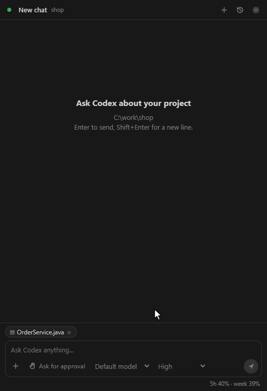

Everything you expect from a Codex chat is there too:
- streaming Markdown answers with clickable `file:line` links; HTML in an answer (a table, `<b>`, `<br>`, `<details>`) is shown as such,
  but only a safe subset: no links, images, buttons, scripts or styles. A ```` ```html ```` block has a **Preview** button that opens it as a static page in an editor tab;
- cards for reasoning, commands, MCP calls and file changes;
- **Allow**, **Allow for session** or **Deny** on approvals;
- the plan checklist and a combined diff of the turn;
- the context and limits in the footer;
- model, reasoning effort and permission pickers, plus plan mode, goals and plugins in the **+** menu;
- `@` file mentions, the active editor file and selected code (right-click > **Codexter: Ask / Explain / Fix selection**).

A few details:
- **Diff** on a changed file opens VS Code's own git changes view.
- **Open Codexter when VS Code starts** (gear): the panel shows at every start, in place of the view used last in that side
  bar, such as Copilot Chat.
- **Rename a chat**: double-click its tab or title, press F2, or use the pencil in the History.
- **Loading an old chat** shows a spinner until it is there (a long chat can take a few seconds the first time).
- Archive, unarchive and delete chats in the History.
- Colours and fonts follow the VS Code theme.
- Codex is downloaded from the npm registry and updated every 7 days. On Windows it lives in `%LOCALAPPDATA%\CodexPanel\codex` and is shared with the Eclipse plugin; on macOS and Linux it lives in the extension's own storage. Proxies (`http.proxy`, `HTTPS_PROXY`) work.

## Install

Install the `.vsix` with Extensions > **...** > **Install from VSIX...**, then press **Ctrl+Alt+C**. Details: [INSTALL.md](INSTALL.md) (English),
[INSTALL.de.md](INSTALL.de.md) (German).

The panel opens in the secondary side bar (VS Code 1.106+; the activity bar before that). Enter sends, Shift+Enter adds a new line.

## Commands

| Command | |
| --- | --- |
| Codexter: Open panel | Ctrl+Alt+C |
| Codexter: New chat | also **+** in the view title |
| Codexter: Ask / Explain / Fix selection | editor context menu |
| Add to Codexter chat | Explorer, editor and editor tab context menus |
| Codexter: Attach files... | |
| Codexter: Generate commit message | Source Control view title |
| Codexter: Code review | also **+** > Code review in the input |
| Codexter: Open settings | also the gear in the view title |
| Codexter: Check for Codex updates | |

## Settings

The gear in the panel opens the settings in folding groups (Model, Quick model, Chat, Instructions, Code review, MCP servers, Dictation, System); the search field on top filters them by name and description.

| Setting | Default | |
| --- | --- | --- |
| `codexPanel.defaultModel` | Codex default | Model a new chat starts with |
| `codexPanel.defaultReasoningEffort` | model default | Reasoning effort a new chat starts with |
| `codexPanel.defaultPermissions` | last used | Permissions a new chat starts with |
| `codexPanel.hiddenModels` | none | Models hidden from the picker |
| `codexPanel.commitMessageModel` | `gpt-6-luna` | Model for commit messages, the AI search and the AI chat names |
| `codexPanel.commitMessageEffort` | `low` | Reasoning effort for these |
| `codexPanel.autoChatNames` | `auto` | AI chat names: `auto` (after the first answer, then every 5), `first` or `off` |
| `codexPanel.dictation` | on | The microphone button (experimental, Windows; uses tokens of your plan) |
| `codexPanel.dictationLanguages` | `["en"]` | Languages you dictate in, from a list (`[]` = any language) |
| `codexPanel.instructionsSource` | `codex` | Whose instructions new chats get: Codex's own or `codexter` |
| `codexPanel.instructions` | empty | Codexter's own instructions |
| `codexPanel.autoCompactTokens` | 0 (Codex's) | Compact a chat when its context reaches this many tokens |
| `codexPanel.systemNotifications` | on | Notifications of the system while VS Code is in the background |
| `codexPanel.openOnStartup` | off | Open the Codexter panel when VS Code starts |
| `codexPanel.fontSize` | 0 (like VS Code) | Font size of the panel |
| `codexPanel.autosave` | on | Save modified editors before a message is sent |
| `codexPanel.codexSource` | `managed` | `managed` (downloaded and updated) or `own` |
| `codexPanel.codexPath` | empty | Your own Codex (`codex.exe`, or `codex` on macOS and Linux) |
| `codexPanel.updateIntervalDays` | 7 | Days between Codex update checks (0 = never) |

The gear in the panel has the most used ones too. The log is in Output > **Codexter**.

## Development

```
npm install
npm run compile     # copies web\ into media\web, then tsc -> out\
npm test            # node:test, no VS Code needed
npm run smoke       # real codex app-server, read-only (account/read, model/list, thread/list); creates, archives and deletes nothing
npm run package     # dist\codex-panel-<version>.vsix
```

Run it from source: open this folder in VS Code and press F5 (Extension Development Host). The page alone runs in a browser:
`web/dev.html` replays recorded Codex sessions (see the top of `web/dev-bridge.js`). Design notes are in `CONCEPT.md`, the history of
changes in `HANDOFF.md`.

- `src/core/` has no vscode imports: `jsonrpc`, `appServer`, `locator`, `installer`, `tar`, `http` (proxy tunnelling), `fileLinks`, `fileIndex`,
  `threadRows`, `droppedPaths`, `unifiedDiff`, `aiSearch`, `mcpServers`, `chatList`, `osNotify`, `rollout`, `instructions`.
- `src/session.ts`, `src/updater.ts` (no vscode imports): the Codex session and the updater.
- `src/extension.ts`, `panel.ts` (webview view), `chatActivity.ts`, `mcpSettings.ts`, `imageEditor.ts`, `dropTarget.ts`, `workspace.ts`,
  `mentions.ts`, `diff.ts`, `proxy.ts`: the VS Code glue.
- `web/` is the page (`app.js`, `app.css`, `imageEditor.js`, ...); `media/web/` is generated from it by `scripts/sync-web.mjs` (do not edit).
- `media/readme/` holds the GIFs of this file (recorded from `web/dev.html`).

Codexter started as a port of the Codex Panel plugin for Eclipse; the two are separate projects now. The extension id is
`UnrealDeveloper.codex-panel` since 0.9.0 (before: `codexpanel.codex-panel`, installed from a vsix), the settings stay `codexPanel.*` and the vsix is named `codex-panel-<version>.vsix`.
